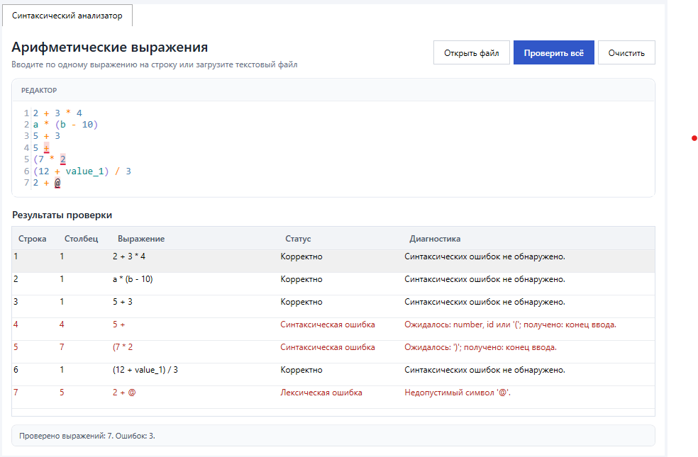

# FormalLanguageTools

Набор библиотек для работы с формальными языками. Решение организовано по отдельным проектам: прикладная логика размещается в специализированных библиотеках, общие типы - в `FormalLanguageTools.Shared`, пользовательский интерфейс - в `FormalLanguageTools.App`, а юнит-тесты - в `FormalLanguageTools.Tests`. `FormalLanguageTools.TestBench` сохранён как консольный стенд для ручной проверки.

## Сборка и запуск

Для сборки всех проектов из корневой папки решения:

```bash
dotnet build
```

Для запуска WPF-приложения:

```bash
dotnet run --project FormalLanguageTools.App
```

После запуска откроется рабочая среда `FormalLanguageTools`. На вкладке синтаксического анализатора можно ввести выражения вручную или загрузить их из текстового файла.

Консольный стенд сохранён и может запускаться отдельно:

```bash
dotnet run --project FormalLanguageTools.TestBench
```

После запуска введите путь к файлу с выражениями. Консольный стенд читает файл и передаёт каждую непустую строку библиотеке парсера.

## Синтаксический анализ арифметических выражений

Анализатор проверяет синтаксическую корректность выражений с целыми числами, идентификаторами, операциями `+`, `-`, `*`, `/` и круглыми скобками. Умножение и деление имеют более высокий приоритет, чем сложение и вычитание. Поддерживаются вложенные скобки. После разбора проверяется, что выражение не содержит лишних токенов.

Используемые терминалы: `+`, `-`, `*`, `/`, `(`, `)`, числа и идентификаторы. Конец входа представлен специальным токеном `EndOfInput`.

### Проекты и исходные файлы

- [`FormalLanguageTools.ArithmeticParser`](FormalLanguageTools.ArithmeticParser/FormalLanguageTools.ArithmeticParser.csproj) - библиотека лексического и синтаксического анализа.
  - [`Interfaces/IArithmeticExpressionParser.cs`](FormalLanguageTools.ArithmeticParser/Interfaces/IArithmeticExpressionParser.cs) - публичный контракт парсера: метод `Parse(string expression)`.
  - [`Classes/ArithmeticExpressionParser.cs`](FormalLanguageTools.ArithmeticParser/Classes/ArithmeticExpressionParser.cs) - точка входа в библиотеку; запускает лексический анализ и передаёт полученные токены синтаксическому анализатору.
  - [`Classes/Lexer.cs`](FormalLanguageTools.ArithmeticParser/Classes/Lexer.cs) - разбивает входную строку на токены, пропускает пробельные символы и фиксирует позиции токенов. Неизвестный символ приводит к `LexicalException`.
  - [`DataClasses/Token.cs`](FormalLanguageTools.ArithmeticParser/DataClasses/Token.cs) - тип токена, его исходное значение и позиция. Тип доступен внутри библиотеки.
  - [`Enums/TokenType.cs`](FormalLanguageTools.ArithmeticParser/Enums/TokenType.cs) - перечисление типов токенов, включая `EndOfInput`; используется внутри библиотеки.
  - [`Classes/RecursiveDescentParser.cs`](FormalLanguageTools.ArithmeticParser/Classes/RecursiveDescentParser.cs) - рекурсивный нисходящий синтаксический анализатор. `ParseExpression` разбирает сложение и вычитание, `ParseTerm` - умножение и деление, `ParseFactor` - числа, идентификаторы и выражения в скобках. После основного разбора проверяется конец ввода.
  - [`Exceptions/LexicalException.cs`](FormalLanguageTools.ArithmeticParser/Exceptions/LexicalException.cs) - исключение для недопустимого символа.
  - [`Exceptions/SyntaxException.cs`](FormalLanguageTools.ArithmeticParser/Exceptions/SyntaxException.cs) - исключение для нарушения грамматики; хранит ожидаемые токены и фактически обнаруженный токен.
- [`FormalLanguageTools.Shared`](FormalLanguageTools.Shared/FormalLanguageTools.Shared.csproj) - общие типы, которые можно использовать в разных библиотеках.
  - [`DataClasses/SourcePosition.cs`](FormalLanguageTools.Shared/DataClasses/SourcePosition.cs) - позиция в тексте: номер строки и столбца.
  - [`Exceptions/FormalLanguageException.cs`](FormalLanguageTools.Shared/Exceptions/FormalLanguageException.cs) - базовый тип исключений формальных языков с позицией ошибки.
- [`FormalLanguageTools.App`](FormalLanguageTools.App/FormalLanguageTools.App.csproj) - WPF-приложение для работы с библиотеками через графический интерфейс.
  - [`MainWindow.xaml`](FormalLanguageTools.App/MainWindow.xaml) - главное окно и `TabControl`, в котором размещаются вкладки инструментов.
  - [`Views/ArithmeticParserView.xaml`](FormalLanguageTools.App/Views/ArithmeticParserView.xaml) - интерфейс синтаксического анализатора: редактор, кнопки открытия файла, проверки и очистки, таблица результатов.
  - [`Views/ArithmeticParserView.xaml.cs`](FormalLanguageTools.App/Views/ArithmeticParserView.xaml.cs) - связывает редактор с моделью представления, обновляет подсветку и обрабатывает переход к выбранной диагностике.
  - [`ViewModels/ArithmeticParserViewModel.cs`](FormalLanguageTools.App/ViewModels/ArithmeticParserViewModel.cs) - выполняет проверку выражений, формирует список диагностик и отображает статус обработки.
  - [`Views/ArithmeticSyntaxColorizer.cs`](FormalLanguageTools.App/Views/ArithmeticSyntaxColorizer.cs) - выполняет базовую подсветку чисел, идентификаторов, операторов и скобок.
  - [`Views/ErrorHighlightRenderer.cs`](FormalLanguageTools.App/Views/ErrorHighlightRenderer.cs) - визуально выделяет позицию ошибки в редакторе.
  - [`Services/WpfTextFileDialogService.cs`](FormalLanguageTools.App/Services/WpfTextFileDialogService.cs) - открывает диалог выбора файла и читает его содержимое на стороне приложения.
- [`FormalLanguageTools.Tests`](FormalLanguageTools.Tests/FormalLanguageTools.Tests.csproj) - проект юнит-тестов на MSTest.
  - [`ArithmeticParser/ArithmeticExpressionParserTests.cs`](FormalLanguageTools.Tests/ArithmeticParser/ArithmeticExpressionParserTests.cs) - тесты парсера: корректные выражения, приоритет операций, идентификаторы, скобки, пустой ввод, ошибки синтаксиса и недопустимые символы.
- [`FormalLanguageTools.TestBench`](FormalLanguageTools.TestBench/FormalLanguageTools.TestBench.csproj) - консольное приложение для ручной проверки библиотеки. Сохранено, но дальнейшее развитие функциональности ведётся в WPF-приложении.
  - [`Program.cs`](FormalLanguageTools.TestBench/Program.cs) - запрашивает путь к файлу, читает строки, передаёт непустые выражения парсеру и выводит результат для каждой строки. Файловый ввод и вывод не включены в библиотеку парсера.
- [`samples/expressions.txt`](samples/expressions.txt) - пример файла, включающий корректные и некорректные выражения.

### Алгоритм разбора

1. `Lexer.Tokenize` преобразует строку в последовательность токенов и добавляет `EndOfInput`.
2. `ArithmeticExpressionParser.Parse` создаёт `RecursiveDescentParser` и запускает синтаксический анализ.
3. Парсер применяет грамматику с разделением выражения, терма и множителя. Это обеспечивает приоритет `*` и `/` над `+` и `-`.
4. Если найдено нарушение синтаксиса или лишний токен после выражения, выбрасывается `SyntaxException`.
5. Если строка разобрана без исключений, вызывающий компонент получает успешный результат.

## Пользовательский интерфейс

Графический интерфейс реализован на WPF. Редактор позволяет вводить несколько выражений - по одному на строку - или загружать текстовый файл. Используется AvalonEdit: в редакторе отображаются номера строк и базовая подсветка чисел, идентификаторов, операторов и скобок. Кнопка «Проверить всё» запускает анализ всех непустых строк, а кнопка «Очистить» удаляет введённый текст и результаты. Результаты отображаются в таблице. Для каждого выражения указываются строка, столбец, исходный текст, статус и сообщение. При выборе диагностики редактор переходит к соответствующей позиции и выделяет её. В нижней части окна показывается общий статус проверки.

### Скриншоты интерфейса



## Запуск юнит-тестов

Юнит-тесты находятся в проекте `FormalLanguageTools.Tests`. Они проверяют как корректные выражения, так и обработку ошибок лексического и синтаксического анализа. Тесты сгруппированы по библиотекам: сейчас используется папка `ArithmeticParser`.

Для запуска всех тестов проекта из корневой папки решения:

```bash
dotnet test
```

## Обработка исключений

- `FormalLanguageException` - базовый класс ошибок формальных языков. Свойство `Position` содержит позицию ошибки.
- `LexicalException` - возникает, если лексер встречает неподдерживаемый символ. Исключение содержит символ `Character` и позицию.
- `SyntaxException` - возникает, если последовательность токенов не соответствует грамматике. Свойства `ExpectedTokens` и `ActualToken` позволяют программно получить ожидаемые и фактический токены.
- Ошибки чтения файла, некорректного или недоступного пути обрабатываются отдельно в [`Program.cs`](FormalLanguageTools.TestBench/Program.cs) для консольного стенда и в [`ViewModels/ArithmeticParserViewModel.cs`](FormalLanguageTools.App/ViewModels/ArithmeticParserViewModel.cs) для WPF-приложения.

Консольный стенд выводит номер строки файла и столбец ошибки. Для синтаксических ошибок сообщение включает ожидаемые токены и фактический токен. Пустой путь и ошибки чтения файла завершают работу с кодом `1`; если были найдены выражения с ошибками анализа, после обработки всего файла возвращается код `2`; если все выражения корректны или в файле нет непустых строк, возвращается код `0`.

## Демонстрация работы

Ниже приведены примеры консольного вывода для поддерживаемых сценариев. В примерах с ошибками номер строки и столбца соответствует указанному выражению.

### Корректное выражение с приоритетом операций

```C#
2 + 3 * 4
```

> Выражение корректно

### Идентификаторы и скобки

```C#
a * (b - 10)
```

> Выражение корректно

### Отсутствует операнд после оператора

```C#
5 + 
```

> Строка 1, столбец 4: Ошибка! Ожидалось: number, id или '('; получено: конец ввода

### Неожиданный токен в начале выражения

```C#
* 2 
```

> Строка 1, столбец 1: Ошибка! Ожидалось: number, id или '('; получено: '*'

### Незакрытая скобка

```C#
(7 * 2 
```

> Строка 1, столбец 7: Ошибка! Ожидалось: ')'; получено: конец ввода

### Лишний токен после выражения

```C#
(1 + 2)) 
```

> Строка 1, столбец 8: Ошибка! Ожидалось: конец выражения; получено: ')'

### Недопустимый символ

```C#
2 + @ 
```

> Строка 1, столбец 5: Ошибка! Недопустимый символ '@'
