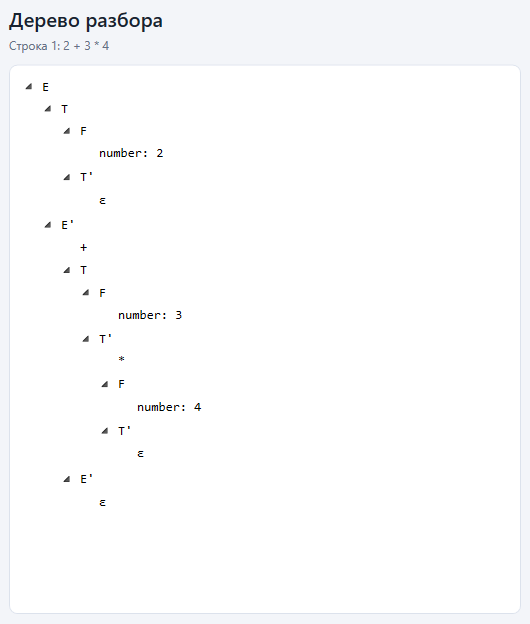
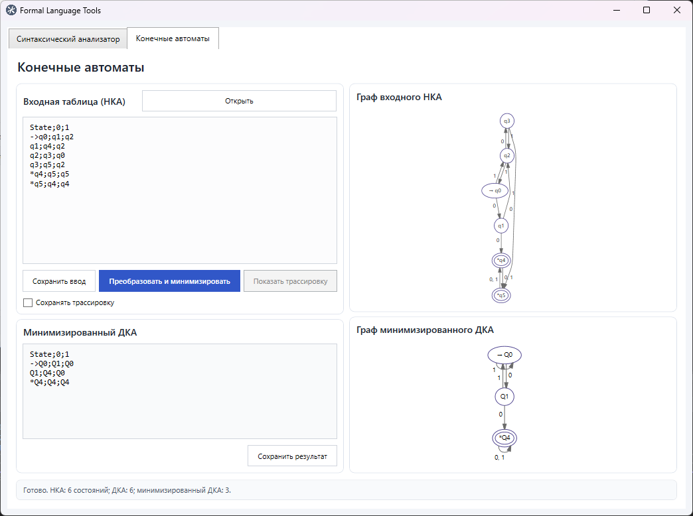
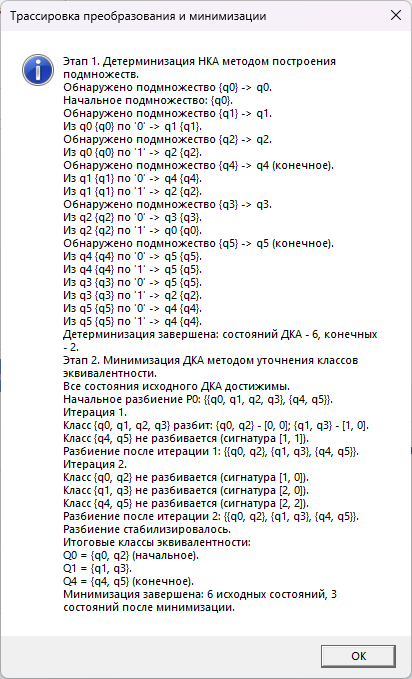

# FormalLanguageTools

Набор библиотек для работы с формальными языками. Решение организовано по отдельным проектам: прикладная логика размещается в специализированных библиотеках, общие типы - в `FormalLanguageTools.Shared`, пользовательский интерфейс - в `FormalLanguageTools.App`, а юнит-тесты - в `FormalLanguageTools.Tests`. `FormalLanguageTools.TestBench` сохранён как консольный стенд для ручной проверки.

## Быстрый старт

### Сборка

Для сборки всех проектов из корневой папки решения:

```bash
dotnet build
```

### Запуск

Для запуска WPF-приложения:

```bash
dotnet run --project FormalLanguageTools.App
```

После запуска откроется рабочая среда `FormalLanguageTools`. На вкладке синтаксического анализатора можно вводить арифметические выражения и просматривать дерево разбора. На вкладке конечных автоматов можно задать таблицу переходов, выполнить детерминизацию и минимизацию, а также просматривать графы автоматов.

Консольный стенд может запускаться отдельно:

```bash
dotnet run --project FormalLanguageTools.TestBench
```

После запуска введите путь к файлу с выражениями. Консольный стенд читает файл и передаёт каждую непустую строку библиотеке парсера.

> [!NOTE]
> Консольный стенд устарел и больше не развивается, далее вся демонстрация работы выполняется в `App`

### Запуск юнит-тестов

Юнит-тесты находятся в проекте `FormalLanguageTools.Tests`. Они проверяют как корректные выражения, так и обработку ошибок лексического и синтаксического анализа. Тесты сгруппированы по библиотекам: сейчас используется папка `ArithmeticParser`.

Для запуска всех тестов проекта из корневой папки решения:

```bash
dotnet test
```

## Синтаксический анализ арифметических выражений

Анализатор проверяет синтаксическую корректность выражений с целыми числами, идентификаторами, операциями `+`, `-`, `*`, `/` и круглыми скобками. Умножение и деление имеют более высокий приоритет, чем сложение и вычитание. Поддерживаются вложенные скобки. После разбора проверяется, что выражение не содержит лишних токенов.

Используемые терминалы: `+`, `-`, `*`, `/`, `(`, `)`, числа и идентификаторы. Конец входа представлен специальным токеном `EndOfInput`.

### Алгоритм разбора

1. `Lexer.Tokenize` преобразует строку в последовательность токенов и добавляет `EndOfInput`.
2. `ArithmeticExpressionParser.Parse` создаёт `RecursiveDescentParser` и запускает синтаксический анализ.
3. Парсер применяет грамматику с разделением выражения, терма и множителя. Это обеспечивает приоритет `*` и `/` над `+` и `-`.
4. При успешном разборе методы парсера создают `SyntaxNode` для нетерминалов и терминалов. Корневым узлом является `E`, а дочерние узлы отражают применённые правила грамматики.
5. Для пустых продолжений `E'` и `T'` создаётся узел `ε`. Если найдено нарушение синтаксиса или лишний токен после выражения, выбрасывается соответствующее исключение и дерево не возвращается.
6. После успешного разбора вызывающий компонент получает корневой узел дерева.

### Правила грамматики

```text
E  → T E'
E' → + T E' | - T E' | ε
T  → F T'
T' → * F T' | / F T' | ε
F  → number | id | ( E )
```

`E` обозначает выражение, `T` - терм, `F` - множитель. `E'` и `T'` описывают возможное продолжение выражения и терма соответственно. Символ `|` разделяет альтернативы, а `ε` обозначает пустую продукцию. Такое разделение правил обеспечивает более высокий приоритет умножения и деления по сравнению со сложением и вычитанием.

### Построение дерева разбора

Метод `Parse(string expression)` возвращает корневой `SyntaxNode` дерева полного разбора. В ходе синтаксического анализа каждый метод создаёт узлы соответствующих нетерминалов (`E`, `E'`, `T`, `T'`, `F`) и терминалов (`number`, `id`, операторы и скобки). Числа и идентификаторы хранят своё значение в узле. Дочерние узлы сохраняют порядок элементов продукции, а пустые продолжения представлены узлом `ε`.

В `FormalLanguageTools.App` дерево сохраняется вместе с результатом проверки выражения. Кнопка «Дерево разбора» доступна для выбранного корректного выражения и открывает отдельное окно [`Views/SyntaxTreeWindow.xaml`](FormalLanguageTools.App/Views/SyntaxTreeWindow.xaml), где структура отображается стандартным WPF `TreeView`. Библиотека парсера только строит дерево и не зависит от способа его отображения.

## Пользовательский интерфейс

Графический интерфейс реализован на WPF. Главное окно содержит отдельные вкладки для инструментов. Сейчас доступны вкладка синтаксического анализа арифметических выражений и вкладка конечных автоматов.

На вкладке синтаксического анализатора можно вводить по одному выражению на строку или загрузить текстовый файл. Редактор отображает номера строк и подсветку токенов. После нажатия «Проверить всё» результаты появляются в таблице. При выборе диагностики редактор переходит к соответствующей позиции. Для корректно разобранного выражения можно открыть дерево разбора.

### Скриншоты интерфейса




## Конечные автоматы и их минимизация

Библиотека принимает таблицу переходов НКА, строит эквивалентный ДКА и минимизирует его. Результат выводится в той же табличной форме. В текущей версии ε-переходы не поддерживаются.

### Формат таблицы переходов

Первая строка содержит `State` и символы алфавита, разделённые точкой с запятой `;`. Каждая следующая строка задаёт состояние и переходы по символам алфавита.

- `->` перед именем обозначает начальное состояние.
- `*` перед именем обозначает конечное состояние. Состояние может одновременно быть начальным и конечным, например `->*q0`.
- `-` обозначает отсутствие перехода для данного символа.
- Несколько возможных переходов из одного состояния по одному символу перечисляются через запятую, например `q0,q1`.
- Повторяющиеся строки состояния разрешены. Их переходы объединяются, дублирующиеся переходы удаляются, а маркеры начального и конечного состояния сохраняются.
- Имя состояния и символ алфавита не должны содержать зарезервированные разделители. Символ `-` зарезервирован и не может использоваться как символ алфавита.

Пример НКА:

```text
State;0;1
->q0;q0,q1;q0
q1;-;q2
*q2;-;-
```

Формат поддерживает чтение и сохранение из файлов UTF-8. По умолчанию при открытии вкладки конечных автоматов уже загружен пример из лекции.

### Алгоритм преобразования

1. `TransitionTableParser.Parse` разбирает текст таблицы, проверяет формат и создаёт модель НКА.
2. `NfaToDfaConverter.Convert` строит ДКА методом подмножеств. Состояния нового автомата соответствуют множествам состояний исходного НКА. Недостижимые подмножества не создаются, а для отсутствующих переходов используется пустое подмножество.
3. `DfaMinimizer.Minimize` удаляет недостижимые состояния, при необходимости завершает функцию переходов поглощающим состоянием и уточняет классы эквивалентности. Процесс продолжается до стабилизации разбиения.
4. Каждый итоговый класс становится состоянием минимизированного ДКА. Переходы, начальное и конечные состояния формируются на основании классов эквивалентности.
5. `TransitionTableFormatter.Format` преобразует минимизированный ДКА обратно в табличный формат. При выводе повторяющиеся строки объединяются в одну строку на состояние.

### Трассировка алгоритма

Трассировка по умолчанию отключена. Чтобы записывать шаги алгоритмов, установите флажок «Сохранять трассировку» перед нажатием «Преобразовать и минимизировать». После успешного выполнения станет доступна кнопка «Показать трассировку».

Трассировка включает построение подмножеств при детерминизации, удаление недостижимых состояний, начальное разбиение на конечные и неконечные состояния, итерации уточнения классов, итоговые классы эквивалентности и количество состояний до и после минимизации. Результат показывается в отдельном `MessageBox`.

### Скриншоты вкладки конечных автоматов





## Обработка исключений

- `FormalLanguageException` - базовый класс ошибок формальных языков. Свойство `Position` содержит позицию ошибки.
- `LexicalException` - возникает, если лексер встречает неподдерживаемый символ. Исключение содержит символ `Character` и позицию.
- `SyntaxException` - возникает, если последовательность токенов не соответствует грамматике. Свойства `ExpectedTokens` и `ActualToken` позволяют программно получить ожидаемые и фактический токены.
- `AutomatonFormatException` - возникает при ошибках таблицы переходов: неверном количестве колонок, повторяющихся символах алфавита, неизвестном состоянии назначения, отсутствии единственного начального состояния и других нарушениях формата. Если возможно, исключение содержит номер строки.
- Ошибки чтения и сохранения файлов обрабатываются в `FormalLanguageTools.TestBench` и `FormalLanguageTools.App`, поскольку файловый ввод и вывод относятся к приложениям, а не к библиотекам алгоритмов.

## Демонстрация работы

Ниже приведены примеры консольного вывода для поддерживаемых сценариев. В примерах с ошибками номер строки и столбца соответствует указанному выражению.

### Корректное выражение с приоритетом операций

```C#
2 + 3 * 4
```

> Выражение корректно

### Идентификаторы и скобки

```C#
a * (b - 10)
```

> Выражение корректно

### Отсутствует операнд после оператора

```C#
5 + 
```

> Строка 1, столбец 4: Ошибка! Ожидалось: number, id или '('; получено: конец ввода

### Неожиданный токен в начале выражения

```C#
* 2 
```

> Строка 1, столбец 1: Ошибка! Ожидалось: number, id или '('; получено: '*'

### Незакрытая скобка

```C#
(7 * 2 
```

> Строка 1, столбец 7: Ошибка! Ожидалось: ')'; получено: конец ввода

### Лишний токен после выражения

```C#
(1 + 2)) 
```

> Строка 1, столбец 8: Ошибка! Ожидалось: конец выражения; получено: ')'

### Недопустимый символ

```C#
2 + @ 
```

> Строка 1, столбец 5: Ошибка! Недопустимый символ '@'

### Минимизация автомата

Вход - содержимое `samples/lecture.txt`:

```text
State;0;1
->q0;q1;q2
q1;q4;q2
q2;q3;q0
q3;q5;q2
*q4;q5;q5
*q5;q4;q4
```

Выход - таблица минимизированного ДКА:

```text
State;0;1
->Q0;Q1;Q0
Q1;Q4;Q0
*Q4;Q4;Q4
```

В результате шесть исходных состояний объединяются в три класса эквивалентности: `Q0 = {q0, q2}`, `Q1 = {q1, q3}`, `Q4 = {q4, q5}`. `Q4` является конечным состоянием.

### Детерминизация НКА

Вход - содержимое `samples/nfa.txt`:

```text
State;0;1
->q0;q0,q1;q0
q1;-;q2
*q2;-;-
```

Парсер принимает несколько переходов по одному символу. При детерминизации состояния ДКА представляют множества состояний НКА, а результирующий ДКА затем передаётся алгоритму минимизации.